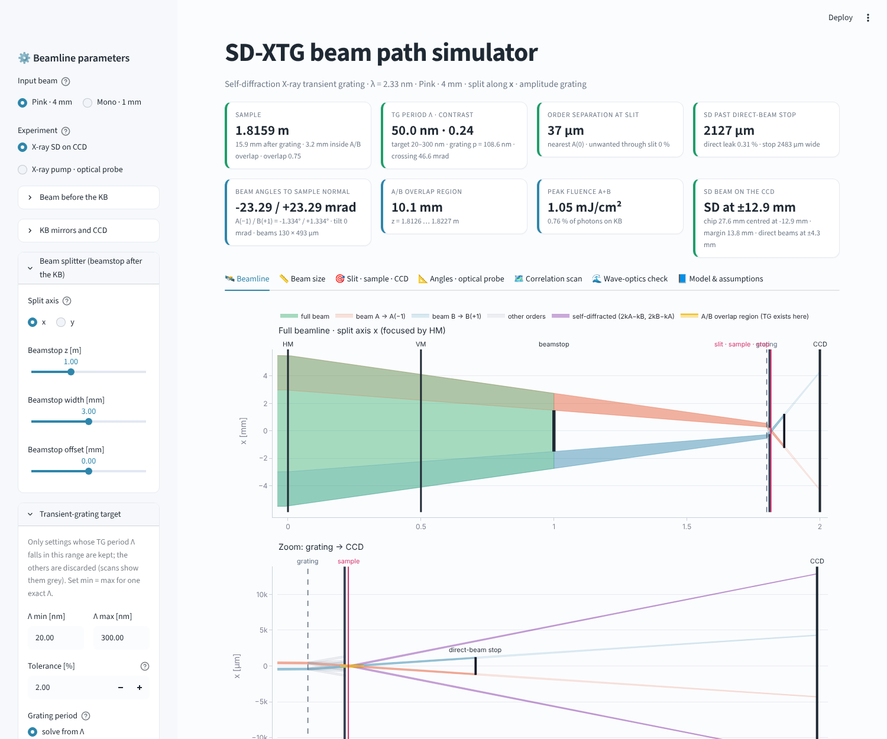

# SD-XTG beam-path simulator (PAL beamtime, O K-edge, 2.33 nm)



A short user note with the physics and how to use the GUI is in [`docs/SDXTG_simulator_guide.pdf`](docs/SDXTG_simulator_guide.pdf).

This simulates the beam path for self-diffraction X-ray transient grating (SD-XTG) after the KB:
KB focusing → beamstop that splits the beam in two → grating → slit that keeps A(−1) and B(+1) →
sample where they cross → direct-beam beamstop → Princeton CCD at the KB focus.

## Files

| file | what it is |
|---|---|
| `sdxtg_app.py` | the GUI, a browser app (Streamlit + Plotly) |
| `run_app.py` | launcher for the GUI (also used when you run `sdxtg_app.py` with Spyder F5 or `python`) |
| `sdxtg_sim.py` | ray-model physics core, correlation scans, and a command line that runs both cases and writes PNG/CSV |
| `sdxtg_wave.py` | wave-optics (Fresnel) propagator used to check the ray model |
| `.streamlit/config.toml` | colour theme of the app |
| `requirements.txt` | Python packages |
| `docs/` | user note (PDF) |
| `examples/` | scan maps, beam-size tables and summaries for both presets, plus screenshots of the app |

```bash
git clone https://github.com/D3nFaina/xtg_and_sdxtg-simulator.git
cd xtg_and_sdxtg-simulator
python -m pip install -r requirements.txt
python sdxtg_app.py
```

## How to run it (step by step)

1. **Install Python 3.9 or newer** if you don't have it (python.org, or Anaconda/Miniconda).
2. **Unzip** `sdxtg_simulator.zip`. You get a folder `sdxtg/`.
3. **Open a terminal** in that folder:
   * macOS: Terminal, then `cd ~/Downloads/sdxtg` (or wherever you unzipped it)
   * Windows: Anaconda Prompt or PowerShell, then `cd C:\Users\<you>\Downloads\sdxtg`
4. **Install the packages** (one time only), into the same Python you will run the app with:
   ```
   python -m pip install numpy matplotlib streamlit plotly
   ```
   Any Streamlit from 1.30 on works (tested with 1.38, 1.45 and 1.66; clicking a scan map needs 1.35+).
5. **Start the GUI**, any of these:
   ```
   python sdxtg_app.py          # or: python run_app.py
   streamlit run sdxtg_app.py   # the classic way
   ```
   **From Spyder:** open `sdxtg_app.py` (or `run_app.py`) and press Run (F5).
   The launcher checks the packages, starts the Streamlit server on the first free port from 8501, waits
   until it answers and opens your browser. It prints the address, so paste it in if no browser opens.
   If something goes wrong it prints the reason, and the full server output is in `sdxtg_app.log`.
   In a terminal stop it with Ctrl+C. In Spyder it keeps running in the background: pressing Run again
   restarts it, and Consoles > Restart kernel stops it.
   If it says a package cannot be imported, it prints the exact `pip install` command for the Python
   that Spyder uses (Spyder's standalone installer has its own Python, separate from Anaconda).
6. *(Optional)* **Batch mode** without the GUI, for both cases with 90 × 90 scans written to PNG + CSV:
   ```
   python sdxtg_sim.py --out results
   python sdxtg_sim.py --nz 150 --np 150 --rays 5000      # finer
   python sdxtg_wave.py                                    # wave-optics check of both presets
   ```

## The app

* **Sidebar:** every parameter, grouped by element: beam, KB and CCD, beam splitter, grating, sample and slit,
  direct-beam beamstop, and numerics. You can save the parameters to JSON and load them back.
* **Status cards:** sample position, TG period, order separation at the slit, unwanted light through the slit,
  overlap, fluence, and SD clearance at the direct-beam beamstop. Green means within the target, red means outside it.
* **Beamline:** the full beamline sketch and a zoom from the grating to the CCD, with all diffraction orders, the slit,
  the sample, the direct-beam beamstop and the self-diffracted beams. Hover for names, drag to zoom.
* **Beam size:** FWHM against z along both axes for the full beam and the A/B beams, plus a table of the size at
  each element that you can download as CSV.
* **Slit · sample · CCD:** profiles at the slit (before the blades), at the sample, at the direct-beam beamstop,
  and the spot pattern on the CCD.
* **Wave-optics check:** runs the Fresnel propagator for the current settings. It compares wave and ray
  profiles at the slit and the sample, shows the TG fringes and their contrast, and draws an x–z intensity map.
* **Correlation scan:** maps over grating position × period, **computed with the sidebar parameters as they are
  when you press Run scan.** You choose the range, the resolution (up to 250 × 250) and the rays per simulation.
  The scan runs on all CPU cores; 90 × 90 takes about 50 s on 4 cores. Clicking a pixel applies that grating z
  and period, and *Apply best point* picks the feasible point with the highest SD figure of merit.

## Target TG period (the hard constraint)

* Sidebar *Transient-grating target*: **Λ min** and **Λ max**. Every setting whose TG period falls outside
  [Λ min, Λ max] (± *Tolerance*, default 2 %) is **discarded**: the status card turns red with a warning, scans
  leave those pixels grey (NaN in the CSV, flagged in the `discarded` column) and they can never be "best point".
  Set Λ min = Λ max for one exact period.
* *Grating period: solve from Λ* (default): the grating period is computed so that A(−1) and B(+1) cross with the
  **Λ setpoint**, using the exact grating equation sin β = sin α ± λ/p on the mean incidence angles of A and B.
  To first order the required period does not depend on the grating position: p ≈ 2λ/(θ − θ_KB), θ = λ/Λ,
  θ_KB = convergence angle of A and B from the KB. The grating position only moves the sample:
  R_sample = R_grating · (2λ/p)/θ. *Set by hand* uses the period you type (Λ follows).
* The largest Λ possible is the one A and B make with no grating at all (KB convergence alone): about 630 nm
  (pink, 3 mm beamstop) and 2.5 µm (mono). The sidebar prints it.
* Scans: the second axis is **Λ over the target range** (grating period solved per pixel), the **grating period**
  (out-of-range pixels discarded), or the **beamstop width** at the Λ setpoint (used automatically for one exact Λ).
* Small Λ means large angles (θ = 47 mrad at 50 nm, 155 mrad at 15 nm). The self-diffracted beams then leave at
  ~1.5 θ and **miss a CCD centred on the axis**: the new map "SD beam on the CCD chip" checks this (chip width
  `ccd_width_mm`, default 27.6 mm). *Move the CCD sideways onto the SD beam* (default on) centres the chip on SD(A)
  and prints the lateral offset needed; switch it off and give `ccd_offset_mm` for a fixed chip.

## Beam angles and the optical-probe mode

* The *Angles · optical probe* tab (and every summary) prints the angles of A(−1) and B(+1) to the **sample
  normal**, the crossing angle and the bisector, and shows Λ = λ / (2 sin(θ/2)). `sample_tilt_mrad` rotates the
  sample; the period along the surface and the tilt of the grating vector are then printed too.
  Example: the old amplitude-grating optimum (pink, beamstop 3 mm, grating 1.467 m, p = 4579 nm) gives
  Λ = 497 nm from A(−1) at −2.346 mrad and B(+1) at +2.346 mrad (∓0.134°), crossing angle 4.69 mrad.
* *Experiment → X-ray pump · optical probe*: the X-ray TG is read by an optical probe (wavelength, incidence angle,
  sample index n, thickness, X-ray attenuation length). Transmission geometry, probe in the split plane. The probe's
  in-plane wavevector picks up ±K_x = ±2π/Λ exactly; the mismatch along the normal Δk_z = k_pz ± K_z − k_dz
  (inside the sample) gives **η_rel = sinc²(Δk_z L / 2)**, L = min(thickness, attenuation length). The tab plots the
  full sinc² curve against the probe angle for both diffracted orders, the Bragg angle sin φ_B = λ_probe/(2Λ), the
  angular acceptance (FWHM) and the exit angle. A diffracted probe exists only for **Λ > λ_probe / 2**, which becomes a
  feasibility condition (the SD/CCD conditions are dropped in this mode). Figure of merit:
  (TG contrast × pump fluence)² × η_rel.

## Geometry and assumptions (all are parameters)

* z is measured from the horizontal mirror (HM). HM at z = 0 with f_H = 2.0 m; VM at z = 0.5 m with f_V = 1.5 m.
  **Each focal length is measured from its own mirror**, so both foci are at z = 2.0 m, where the CCD is.
  If f_V is meant from the HM instead, set f_V = 1.0.
* Focal spot 40 µm FWHM in both axes. The diffraction limit at 2.33 nm is about 1 µm, so the 40 µm (source size,
  mirror errors) is an input.
* Input beam before the KB is Gaussian, 4 mm FWHM (pink) or 1 mm FWHM (mono); `flattop` is also available.
* Bandwidth and pulse energy are **placeholders** (pink 0.5 %, 100 µJ; mono 0.02 %, 10 µJ). The absolute fluence
  scales with them.
* The beamstop after the KB is a bar along the split axis (default x). It leaves half-beam A (x > 0) and
  half-beam B (x < 0), which still converge to the common focus.
* Grating lines run perpendicular to the split axis. A(−1) and B(+1) bend towards the axis and cross before the
  focus, and that crossing is where the sample goes (`crossing` mode). `fixed` keeps the sample at a given z.
* Grating efficiency comes from the binary-grating Fourier coefficients (the `EnxPhase` expression from
  `talbot_tutorial.ipynb`, without the Hamming taper). `amplitude` = bars with transmission T and no phase
  (opaque: η±1 = 10.1 %, η0 = 25 %). `phase` = bars with phase φ (π, T = 1: η±1 = 40.5 %, η0 = 0).
* The slit is two blades `slit_upstream_mm` before the sample; auto mode opens them to the 1–99 % extent of the wanted orders.
* **The direct-beam beamstop** sits `dbs_after_sample_mm` downstream of the sample (default 50 mm for pink and
  100 mm for mono, so it starts close to the sample and follows it). Auto mode sizes it to just cover the
  transmitted A(−1) and B(+1). The SD beams (2k_A − k_B, 2k_B − k_A) have to pass beside it. Close to the sample the
  SD and direct beams have not separated yet, so the SD clearance shows how close you can go.

## Is the propagation physically accurate?

Two independent models are included, and they agree.

**1. Ray model (`sdxtg_sim.py`, used for everything interactive and for the scans).** Paraxial geometric
optics. Each ray has a mirror-plane position u (the beam profile), a focal-plane position ξ (the 40 µm spot) and
a wavelength (the bandwidth): x(z) = u + (ξ − u)(z − z_mirror)/f. At the grating, order n is deflected with the
**exact grating equation** sin β = sin α + nλ/p (straight lines afterwards), with the efficiency |E_n|² of the
binary grating, and Λ uses the exact angle between the beams. So the model stays right at the large angles of
Λ = 10–100 nm (θ up to ~0.2 rad). The envelopes are accurate because the Fresnel numbers are large:
a²/(λL) ≈ 10³ for the beam and about 10 even for the 100 µm beams near the sample. Rays are sampled mirror-symmetrically, so A and B
are exact mirror images unless you offset the beamstop.

**2. Wave-optics model (`sdxtg_wave.py`, the "Wave-optics check" tab).** Scalar Fresnel propagation of the
complex field along the split axis. The converging beam is handled with the Fresnel scaling theorem: the field is
written relative to the sphere converging to the focus, and the grid shrinks with the beam, so every step is an
exact FFT propagation. Beamstop and slit are hard masks, and the grating is its Fourier series. Each diffraction
order is carried as envelope × carrier exp(i2πnx/p): the Fresnel step moves and rescales the envelope and the
carrier is propagated analytically, so the grid never has to resolve the grating period, and the orders are added
coherently at the sample on a grid of Λ/10. This works down to Λ ≈ 15 nm; the transverse wavevectors (so Λ) are
exact, and the paraxial defocus error is ~1.5 θ² (0.1 % at 50 nm, 4 % at 15 nm). Partial coherence
is a Gaussian Schell model (an incoherent sum over tilted beams), and bandwidth is an incoherent sum over
wavelengths. This model includes everything the rays leave out: edge diffraction, interference, the TG fringes
themselves and their contrast.

**Cross-check:** the profiles at the slit and at the sample agree. The ray profiles are slightly wider
because of the 40 µm blur, which the wave model does not include. TG contrast and Λ (wave vs ray):
pink Λ = 50 nm: 0.239 vs 0.240, 50.00 vs 50.02 nm; pink Λ = 20 nm: 0.240 vs 0.235, 20.00 vs 20.00 nm;
pink Λ = 250 nm: 0.238 vs 0.234; mono Λ = 50 nm: 0.243 vs 0.235; earlier phase-grating example 0.42 vs 0.44.

**Two physics points the wave model settled:**
* **Bandwidth does not wash out the fringes.** In this geometry the TG is the converging-beam image of the
  grating's ±1 interference, so Λ = (p/2)·R_sample/R_grating for every wavelength. Even 2 % bandwidth leaves the
  contrast unchanged.
* **Transverse coherence between A and B does matter.** The A and B rays that meet at a sample point left the KB
  Δu apart, which is 7.4 mm for the pink default. The fringes need A and B to be mutually coherent over that
  distance. With coherence length = 2.7 × rms beam size (about 80 % global coherence, typical for SASE), the
  coherence factor is about 0.3. A wide beamstop, which is needed to keep the zero orders out of the slit, pushes
  A and B into the tails and lowers the contrast. **Set `coh_ratio` to the measured PAL-XFEL coherence**,
  because this is the main trade-off.

**Not modelled:** mirror figure errors (only through the 40 µm blur in the ray model), the second axis in the
wave model (it is separable and does not affect the split-axis physics), absorption and phase in the sample, and
the time structure of SASE pulses.

## What each correlation map shows

Each pixel is one full simulation at that grating z and period. Every other parameter is held at the value shown
in the figure caption. In `crossing` mode the sample moves to the A(−1)/B(+1) crossing for every pixel; the slit
stays `slit_upstream_mm` before it and the direct-beam beamstop stays `dbs_after_sample_mm` after it. The y axis
axis is Λ (target range, log), the grating period (log) or the beamstop width. Grey = discarded (Λ outside the
target) or no valid setting. The black/white outline marks the **feasible region**: Λ in the target, the sample
inside the A/B overlap region, separation at the slit > 20 µm, unwanted light < 1 %, overlap > 0.5, and either
(SD mode) SD clearance > 20 µm and an SD beam on the CCD chip, or (optical mode) Λ > λ_probe/2 (thresholds in
`feasible_mask()`). The star is the current setting. Default maps (SD mode): (a) grating → sample distance,
(b) grating period used, (c) Λ, (d) sample inside the overlap region, (e) overlap, (f) TG contrast, (g) fluence,
(h) separation at slit, (i) unwanted light, (j) SD clearance, (k) SD beam on the CCD chip, (l) SD figure of merit.
In optical mode (j)–(l) are the A(−1) angle to the normal, the probe Bragg angle and the optical-probe figure of merit.

| map | definition |
|---|---|
| (a) Grating → sample distance [mm] | distance from the grating to the sample; in crossing mode, where the A(−1) and B(+1) centroids meet |
| (b) TG period Λ [nm] | λ / (2 sin(θ/2)), θ = angle between the mean directions of A(−1) and B(+1) at the sample |
| (c) Sample inside the A/B overlap region [mm] | distance from the sample to the nearest end of the "rhombus" where the 2–98 % bands of A(−1) and B(+1) intersect; > 0 means a TG exists at the sample |
| (d) Spatial overlap | ∫I_A I_B dx / √(∫I_A² ∫I_B²) along the split axis at the sample; 1 = identical profiles on top of each other. Two mirror-image half-beams reach about 0.8, more near the focus where the blur rounds them |
| (e) TG fringe contrast | Σ 2√(I_A I_B)·V / Σ(I_A+I_B) over the sample, V = mutual coherence of the A and B rays that meet (see above) |
| (f) Peak fluence A(−1)+B(+1) [mJ/cm²] | sum of the Gaussian-equivalent peak fluences E·P/(1.133·FWHM_x·FWHM_y) of the two 1st orders after the slit |
| (g) Order separation at slit [µm] | smallest edge-to-edge gap (1 %/99 % quantiles) at the slit between a wanted order and the nearest unwanted one (orders < 0.1 % of η±1 ignored); > 0 means the slit can separate them |
| (h) Unwanted light through slit [%] | power of all unwanted orders that pass the slit opening, relative to A(−1)+B(+1) |
| (i) SD clearance at direct-beam beamstop [µm] | gap between the beamstop edge and the nearest SD beam at the beamstop plane; > 0 means the SD signal reaches the CCD |
| Grating period used [nm] | the grating period of the pixel (solved from Λ when the axis is Λ or the beamstop width) |
| SD beam on the CCD chip [mm] | distance from the better-placed SD beam's 1–99 % edge to the nearest chip edge; > 0 means it lands fully on the chip |
| Angle of A(−1) to the sample normal [mrad] | B(+1) is at the mirror angle for an untilted sample |
| Optical probe Bragg angle [deg], phase-matching factor, optical-probe FOM | see "Beam angles and the optical-probe mode" |
| also available | photons in the 1st orders, 1st-order beam size at the sample, length of the overlap region, SD figure of merit ((TG contrast)² × F_A × F_B × (F_A+F_B)/2), pulse-front tilt, sample z |

## First results (defaults)

* **The A/B overlap region.** In `crossing` mode the sample sits at the crossing of the A(−1) and B(+1) centroids,
  which is inside the overlap rhombus by construction. The app shows the rhombus in yellow and reports how far
  inside it the sample is. In `fixed` mode, a sample outside it is flagged ("no transient grating"), and its
  contrast and figure of merit are set to 0. The feasibility check requires it in every case.
* The beamstop after the KB has to be **wider than the beam FWHM at its position (about 1.3–1.5×) with an
  amplitude grating**. Otherwise the zero orders leak through the slit for every grating setting. That pushes A and B
  into the beam tails, so the TG contrast is only about 0.25 for partially coherent SASE (coh_ratio = 2.7).
* Presets (amplitude grating, Λ target 20–300 nm, setpoint 50 nm): pink: beamstop 3.0 mm at 1.0 m, grating
  1.80 m, p = 108.6 nm (solved) → sample 1.816 m (15.9 mm after the grating), A(−1)/B(+1) at ∓23.29 mrad
  (∓1.334°) to the normal, overlap region 10.3 mm, contrast 0.24 (wave 0.24), SD beams at ±12.9 mm on the CCD.
  Mono: beamstop 0.75 mm, grating 1.45 m, p = 102.0 nm → sample 1.461 m, ∓23.30 mrad, overlap region 7.2 mm,
  contrast 0.24 (wave 0.25), SD beams at ±37.7 mm on the CCD (chip moved sideways).
* The 90 × 90 scans over grating z × Λ (20–300 nm) are feasible over most of the map for pink (6090 of 8100
  points); the limits are the order separation at the slit close to the focus and the SD clearance at large Λ
  with the grating far upstream. Earlier (before the Λ target) the best amplitude-grating point was
  z_g = 1.467 m, p = 4579 nm: Λ = 497 nm, from beams at ∓2.35 mrad.
* A **π phase grating** (duty 0.5) has no zero order, so a smaller beamstop is enough and A and B stay closer
  together. In the scans it roughly doubles the contrast (about 0.4–0.45) and gives about 30× the fluence. For example,
  pink: beamstop 2.0 mm, grating 1.65 m, p = 6 µm → contrast 0.42 (wave) / 0.44 (ray), about 58 mJ/cm².
  Mono: beamstop 0.5 mm, grating 1.58 m, p = 6 µm → contrast 0.43 / 0.45. Use `bar_T` for the real bar absorption at 532 eV.
* Moving the direct-beam beamstop further from the sample widens the feasible region (the SD beams need distance
  to separate from the direct beams).
